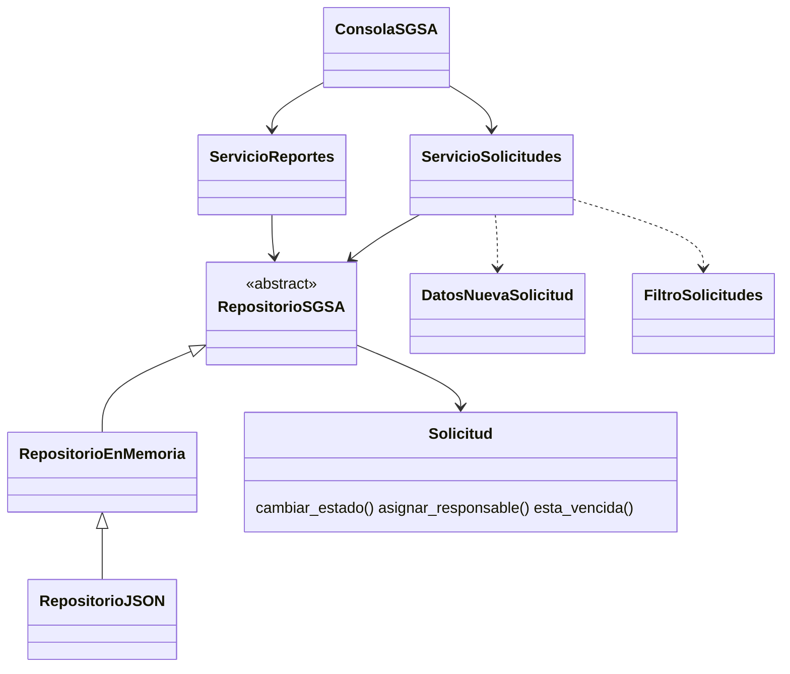

# Etapa 4 — Aplicación de SOLID y Clean Code

## Arquitectura resultante (capas)
```
sistema.py                 → punto de entrada (mismo comando que la versión inicial)
sgsa/ui/                   → consola.py (entrada/salida), formato.py (textos)
sgsa/servicios/            → ServicioSolicitudes, ServicioReportes (casos de uso)
sgsa/dominio/              → enums, modelos, reglas, validadores, excepciones
sgsa/persistencia/         → RepositorioSGSA (abstracción), RepositorioEnMemoria, RepositorioJSON
```
Dependencias: `ui → servicios → dominio` y `servicios → RepositorioSGSA (abstracción)`. Solo `construir_consola()` (composition root) conoce la implementación JSON.



## Principios SOLID
| Principio | Problema en la versión inicial | Mejora aplicada | Dónde |
|---|---|---|---|
| **SRP** | `GestorSolicitudes` tenía 5 motivos de cambio (CS-01). | Cada clase tiene un motivo de cambio: UI, casos de uso, reglas, persistencia, reporte. | `ui/`, `servicios/`, `dominio/`, `persistencia/` |
| **OCP** | if/elif para prioridad, transiciones, contadores y menú (CS-06). | Reglas como **tablas de datos**: `PRIORIDAD_AUTOMATICA_POR_TIPO`, `TRANSICIONES_PERMITIDAS`; menú como diccionario; el reporte itera los enums. Agregar un tipo = 1 línea en el enum + 1 en la tabla. Una prueba (`test_todo_tipo_tiene_prioridad_automatica`) avisa si falta la regla. | `dominio/reglas.py`, `ui/consola.py` |
| **LSP** | No había jerarquías. | `RepositorioJSON` y `RepositorioEnMemoria` cumplen el mismo contrato: los servicios funcionan igual con cualquiera (las pruebas unitarias usan memoria y la aplicación usa JSON). | `persistencia/` |
| **ISP** | — | La interfaz `RepositorioSGSA` expone solo las 8 operaciones que los servicios usan (6 abstractas y 2 con implementación por defecto). **Decisión:** no se dividió en más interfaces porque ambos servicios son clientes cohesivos del mismo agregado; dividirla hoy sería sobreingeniería. Queda como criterio para el futuro. | `persistencia/repositorio.py` |
| **DIP** | La lógica abría `datos.json` directamente y usaba un global (CS-08). | Los servicios reciben el repositorio por constructor (inyección de dependencias) y dependen de la abstracción. | `servicios/*.py`, `construir_consola()` |

## Clean Code
| Práctica | Antes | Después |
|---|---|---|
| Nombres expresivos | `d`, `p`, `t`, `x`, `flag`, `c1..c4` | `descripcion`, `prioridad`, `tipo`, `solicitud`, `transicion_permitida()`, `por_estado` |
| Funciones pequeñas, un nivel de abstracción | CC máx. 23, promedio 12,4 | CC máx. 5, promedio 1,9 |
| Manejo de errores | `except:` desnudo, `print`+`return`, error de datos oculto | Jerarquía `ErrorSGSA`; las reglas lanzan excepciones y la UI las muestra en **un solo lugar** (`_ejecutar_opcion`); archivo dañado se informa y no se pisa |
| Sin duplicación (DRY) | Validaciones y guardado copiados 3-4 veces | `validadores.py` y `_guardar()` únicos |
| Constantes con nombre | `3`, `4`, `6`, `10`, `"EP"` | `DIAS_MAXIMOS_SIN_ATENDER`, `LONGITUD_MINIMA_LEGAJO`, `Estado.EN_PROCESO` |
| Comentarios | Explicaban el "qué" o pedían perdón | Docstrings que explican el "por qué" (p. ej. por qué no se oculta el JSON dañado) |
| Recursos | `open()`/`close()` manual | `Path.read_text()`/`write_text()` |
| Cohesión / acoplamiento | Lógica de estados dispersa en la UI | La entidad `Solicitud` protege sus invariantes (transiciones, vencimiento, asignación) |
